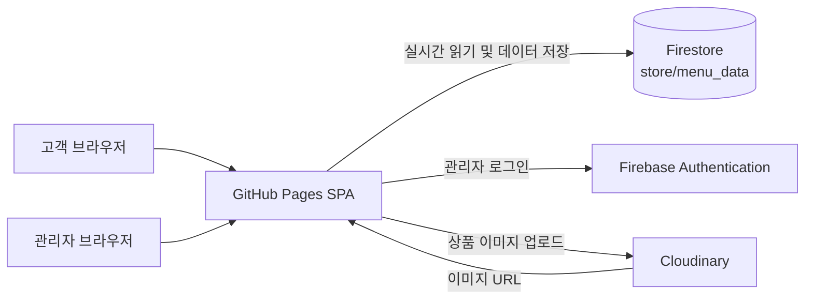

# 리리빵집 재고알리미

## 프로젝트 개요
빵집의 당일 상품과 재고를 손님에게 실시간으로 안내하고, 매장 관리자가 상품 및 매장 정보를 웹에서 관리할 수 있는 모바일 중심 웹 애플리케이션입니다.

## 서비스 접속 방법
스마트폰 카메라로 아래 QR 코드를 스캔하면 서비스에 접속할 수 있습니다.

## 시연 영상 및 화면
- 서비스 URL: [작성 필요]
- 시연 영상: [작성 필요]
- 고객 화면 캡처: [이미지 경로 또는 링크 작성 필요]
- 관리자 화면 캡처: [이미지 경로 또는 링크 작성 필요]

## 주요 기능
- 고객 화면에서 판매 중인 상품과 재고 현황을 확인하고, 카테고리 및 상품명으로 검색할 수 있습니다.
- 상품의 품절 상태와 매장 영업 여부를 확인할 수 있습니다.
- 관리자는 로그인 후 상품 등록·수정·삭제, 재고·품절·노출 상태를 관리할 수 있습니다.
- 공지, 휴무 안내, 주문 안내 문구와 카카오톡 문의 링크를 설정할 수 있습니다.
- 상품 이미지를 자르고 WebP로 변환해 업로드할 수 있습니다.
- Firestore 변경 사항을 실시간으로 반영하며, 브라우저 탭이 숨겨지면 실시간 구독을 중지합니다.

## 손님 트래픽 측정 설정
- Firebase 웹 앱의 측정 ID를 GitHub 저장소의 Actions 시크릿 `VITE_FIREBASE_MEASUREMENT_ID`로 등록합니다. 로컬에서 프로덕션 빌드를 확인할 때는 동일한 환경 변수를 설정합니다.
- GA4 웹 데이터 스트림의 향상된 측정 설정에서 페이지 조회의 브라우저 기록 변경에 따른 자동 페이지 조회를 비활성화합니다. HashRouter의 관리자 경로 이동이 자동 페이지뷰로 집계되는 것을 방지하기 위한 설정입니다.
- 손님 화면의 페이지뷰와 카카오톡 주문 안내 열기, 채팅 링크 클릭을 측정합니다. 개발 모드에서는 Analytics를 수집하지 않습니다.

## 기술 스택
| 구분 | 기술 |
| --- | --- |
| 프론트엔드 | React 19, TypeScript, Vite |
| 스타일링 | Tailwind CSS v4 |
| 라우팅 | React Router의 HashRouter |
| 데이터베이스 및 인증 | Firebase Firestore, Firebase Authentication |
| 이미지 처리 및 호스팅 | HTML Canvas, Cloudinary unsigned upload |
| 배포 | GitHub Pages, GitHub Actions |

## 서비스 아키텍처
고객과 관리자는 GitHub Pages에 배포된 SPA에 접속합니다. 앱은 Firebase Authentication으로 관리자 로그인 상태를 확인하고, Firestore의 단일 `store/menu_data` 문서에서 상품과 매장 데이터를 읽고 씁니다. 상품 이미지는 브라우저에서 가로 최대 400px, WebP 품질 0.75로 변환한 뒤 Cloudinary에 업로드하고, 반환된 이미지 URL을 Firestore 데이터에 저장합니다.

